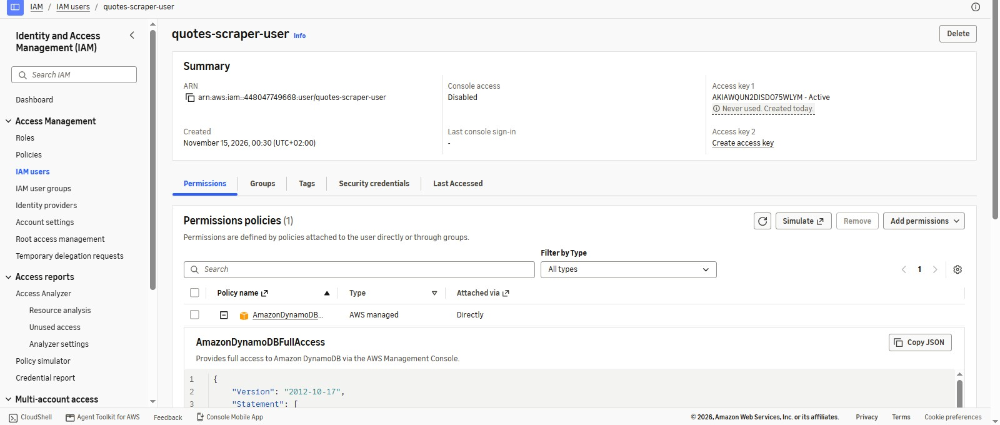

# 🏗️ AWS Cloud Data Scraping & Analytics Pipeline

## 📌 Project Overview
This project demonstrates a complete, end-to-end data engineering and analytics pipeline. It extracts data from static and dynamic websites using Python, stores it in AWS DynamoDB, cleans the data, and hosts an interactive analytics dashboard on an AWS S3 bucket.

**Real-world focus:** The main application targets **Property24**, a South African property listings portal, to analyze housing market trends in Gauteng.

**🌐 Live dashboard:** http://namebucket.s3-website-us-west-2.amazonaws.com/

## 🗺️ Architecture Diagram


**Data flow:**
1. **Extraction:** Python scrapers (`requests`, `BeautifulSoup`, `Selenium`) extract data from a static website (Quotes) and a dynamic website (Property24).
2. **Authentication:** The AWS CLI connects my Windows computer to AWS using IAM user credentials.
3. **Storage:** The `boto3` library writes the scraped data into two DynamoDB tables.
4. **Transformation:** The data is exported to CSV, cleaned with spreadsheet formulas, and analyzed with Pivot Tables.
5. **Hosting:** A custom analytics dashboard (HTML/JS) is uploaded to an S3 bucket with Static Website Hosting enabled for public viewing.

---

## 🛠️ Step-by-Step Implementation

### 1. AWS Security & Environment Setup
* Created an IAM user with programmatic access and attached the `AmazonDynamoDBFullAccess` policy.
* Configured the AWS CLI in Windows PowerShell with `aws configure`.
* Installed the required Python libraries: `requests`, `beautifulsoup4`, `boto3`, `selenium`, `webdriver-manager`.



### 2. DynamoDB Database Provisioning
* **Table 1:** `QuotesTable` (partition key: `Quote_id`, sort key: `Author_name`).
* **Table 2:** `Property24Listings` (partition key: `listing_id`, sort key: `scraped_at`).


### 3. Web Scraping (Static & Dynamic)
* **Static scraper:** Used `BeautifulSoup` to parse HTML.
* **Dynamic scraper (Selenium):** Used Selenium WebDriver to handle JavaScript-rendered pages, with `WebDriverWait` to make sure elements loaded before extraction.
* **The Property24 challenge:** The first Property24 script failed because the HTML was nested. I used Chrome DevTools to find the correct CSS selector (`.p24_description`) and used string handling to separate the price from the location.


### 4. Data Transformation & Cleaning
Exported the DynamoDB data to CSV. Used a spreadsheet program to convert text-based prices (`=VALUE(SUBSTITUTE(...))`) into numbers, and used Pivot Tables to group duplicate listings and calculate the average price per suburb.


### 5. Analytics Dashboard & AWS S3 Hosting
Built an interactive HTML/JS dashboard showing key metrics (median price, price bands, cheapest and most expensive listings). Uploaded the file to Amazon S3, enabled **Static Website Hosting**, and added a bucket policy for public read access.


### 🌐 Live Dashboard
The final product turns raw scraped data into insights about the South African housing market.


---

## 📊 Key Findings
Data scraped on 15 November 2026 from Gauteng listings.

| Measure | Result |
|---|---|
| Rows scraped | 88 |
| Unique listings (after removing duplicates) | 43 |
| Listings with a price | 40 |
| Median asking price | R1,747,500 |
| Median house vs apartment | R2.1M vs R930k |
| Largest price band | R1.5M–R2.5M (13 of 40 listings) |

The average price (about R3.4M) is much higher than the median because of two listings above R29M, so the median is the fairer measure. With only 40 priced listings, treat this as a snapshot, not a market report.

---

## 💻 Technologies Used
* **Languages:** Python, HTML, CSS, JavaScript
* **Libraries:** Selenium, BeautifulSoup, Requests, Boto3, Hashlib
* **AWS Services:** IAM, DynamoDB, S3, AWS CLI
* **Data Tools:** Spreadsheet (Pivot Tables, Formulas)

## 📁 Repository Structure
```
aws-property24-data-pipeline/
├── README.md
├── scripts/
│   ├── property24_scraper.py
│   └── export_data.py
├── data/
│   └── property_data.csv
├── dashboard/
│   └── index.html
└── screenshots/
    ├── 01 architecture-diagram.jpg
    ├── 02.iam-user-setup.jpg
    ├── 03 dynamodb-tables.jpg
    ├── 04 terminal-execution.jpg
    ├── 05 dynamodb-property-data.jpg
    ├── 06 pivot-table-chart.jpg
    ├── 07 s3-bucket.jpg
    └── 08 live-dashboard.jpg
```

## 🚀 How to Run Locally
**Requirements:** Python 3, Google Chrome, and an AWS account.

1. Clone the repository: `git clone https://github.com/khwezi407/aws-property24-data-pipeline.git`
2. Install dependencies: `pip install requests beautifulsoup4 boto3 selenium webdriver-manager`
3. Configure AWS: `aws configure` (enter your own IAM keys).
4. Run the Property24 scraper: `python scripts/property24_scraper.py`
5. Export the data: `python scripts/export_data.py`

## 🔒 Security Notes
* Never commit AWS access keys to GitHub. Keep them in `aws configure` only.
* The S3 bucket is public, so it only holds public listing data.
* Scraping was done on a small scale for learning. Check a site's terms of use and `robots.txt` before scraping.

---
*Created as part of the AWS re/Start Special Project.*
